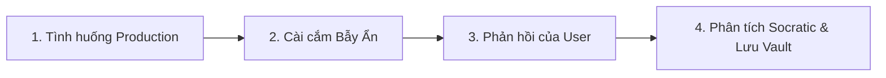

# 🕳️ Hidden Case Trainer Skill (`hidden-case-trainer`)

## 1. Mục tiêu
Người học thường chỉ nhớ "Happy Path" (trường hợp lý tưởng). Kỹ năng này đóng vai trò là một Principal Engineer chuyên "bẻ cong" giải pháp của người học bằng cách đặt ra các **Hidden Cases (Bẫy ẩn)** trong môi trường Production:
* Concurrency / Race Conditions / Deadlocks
* Memory Leaks / Heap Bloat / Retained References
* Shallow Copy vs Deep Copy Mutation
* Boundary Traps / Off-by-one / Silent Failures
* Constructor Initialization Order / Leaking `this`

---

## 2. Quy trình Huấn luyện 4 Bước (The Hidden Trap Protocol)



1. **Khởi tạo Tình huống:** Tạo đoạn mã hoặc kịch bản mô phỏng lỗi thực tế trong hệ thống lớn.
2. **Cài cắm Bẫy Ẩn:** Đưa vào một khiếm khuyết tinh vi mà các bài giảng thông thường không nhắc tới.
3. **Thử thách Phản xạ:** Cho người học giải thích hoặc sửa lỗi.
4. **Phân tích Socratic & Ghi nhật ký:**
   * Khen ngợi điểm hợp lý.
   * Chỉ ra chính xác lý do tại sao giải pháp thất bại trong điều kiện tải cao hoặc dữ liệu đặc thù.
   * Ghi nhận lỗi vào `HIDDEN_CASE_VAULT.json`.

---

## 3. Cấu trúc `HIDDEN_CASE_VAULT.json`
Theo dõi tần suất người dùng mắc bẫy để tự động đưa vào các buổi ôn tập sau:
```json
{
  "topic": "Kotlin Master",
  "traps": [
    {
      "id": "trap-shallow-copy",
      "title": "Bẫy Shallow Copy trên MutableList trong data class",
      "underlyingMechanism": "Tham chiếu Heap bị chia sẻ giữa các instance sau khi copy",
      "userMistakeHistory": { "encounteredCount": 1, "failedCount": 0, "lastTestedDate": "2026-10-30" }
    }
  ]
}
```
