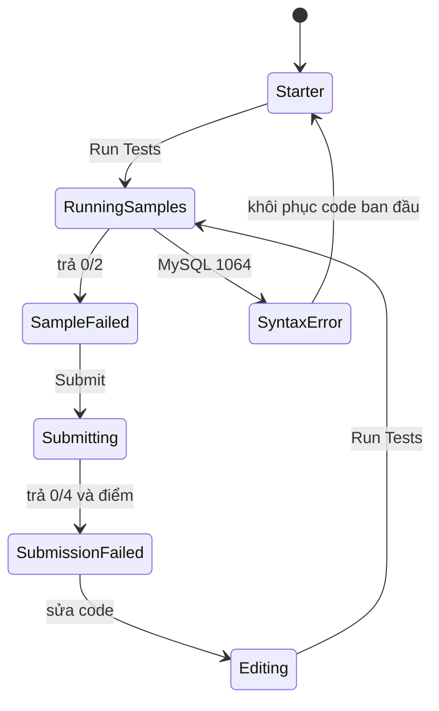
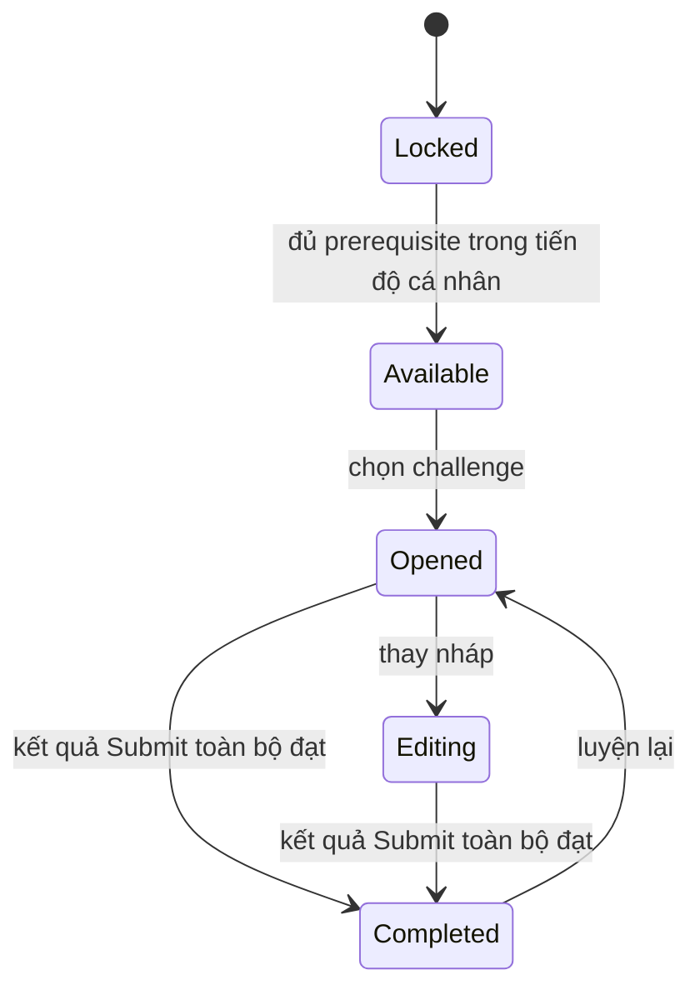
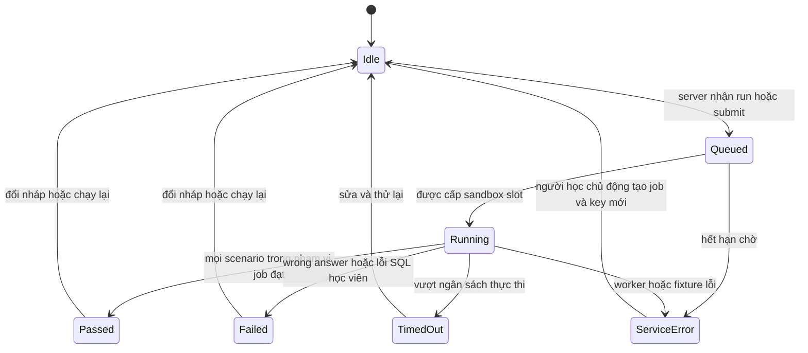

# 04. Mô hình trạng thái

Tên state dưới đây là ngôn ngữ đặc tả của nghiên cứu, không phải tên enum đã khôi phục từ CodeFights. Căn cứ quan sát nằm ở [03](03-technical-observation.md), [Evidence Register](evidence-register.md).

## 1. Những trạng thái lịch sử có bằng chứng

| Thành phần | Trạng thái nhìn thấy | Chuyển trạng thái còn thiếu |
|---|---|---|
| Map 2017 | Node xanh không hiện khóa, node có khóa, world khóa [H-03-M] | Màu xanh là đang chọn/khả dụng/đã hoàn thành chưa xác minh; guard mở khóa chưa biết |
| Editor 2017 | Code, ngôn ngữ và Saved [H-03-I] | Chu kỳ/lỗi lưu, đổi ngôn ngữ, phục hồi nháp |
| Test 2017 | Sample passed; test khóa [H-03-I] | Request nào chạy hidden, mua quyền xem thay đổi state nào |
| Kết quả lịch sử | Score đầy ở screenshot [H-06] | Trình tự nộp thành công và cấp thưởng |

Không vẽ mũi tên đã được xác nhận chỉ từ hai ảnh khác trạng thái. Luật sao khi launch [H-01] và thông tin Coin của bản sau [H-04] không gộp thành một state machine lịch sử duy nhất.

## 2. Workspace hiện tại đã tương tác

Đây là đường đã thử [B-02, B-03, B-06, B-07]. Không có cạnh tới Completed vì chưa chạy một lời giải đúng. Nội dung starter được phục hồi nhưng test result cũ vẫn còn; không gọi đó là hoàn tác toàn bộ phiên.

## 3. State machine SQL Arcade đề xuất — RECOMMENDATION

Tách **khả dụng challenge**, **nháp editor** và **job chạy/chấm**. Một challenge đã hoàn thành vẫn mở lại được; việc sửa code không xóa lần hoàn thành cá nhân trước đó. [BR-01, BR-02, BR-06]

Khóa MVP là hướng dẫn học trên client, không phải kiểm soát truy cập server hoặc chứng nhận chống gian lận. Có thể sửa local progress để bỏ qua; sản phẩm phải nói rõ giới hạn này. Chuyển sang khóa đáng tin cậy cần identity/progress server ở giai đoạn sau.

`Passed` của Run chỉ có nghĩa visible suite đạt. Chỉ `Passed` của Submit mới cập nhật hoàn thành. Đổi nháp làm kết quả hiển thị thành “kết quả của bản trước”; late response vẫn thuộc SQL hash/challenge version đã nộp. Không áp verdict cũ cho mã mới. [FR-04, FR-05, FR-06]

## 4. Guards và tác dụng phụ

| Sự kiện | Guard | Tác dụng phụ | Failure path |
|---|---|---|---|
| Tạo job | Code hợp lệ, version được phục vụ, policy SQL, quota, idempotency | Lưu snapshot bất biến; xếp hàng | 400/401/409/422/429, giữ nháp |
| Cấp slot | Lease độc quyền, reset/healthcheck thành công | Chạy một scenario tại một thời điểm | Quarantine slot nếu reset thất bại |
| Run đạt | Chỉ visible suite | Hiện chi tiết sample, không thưởng | Không có quyền kết luận hidden |
| Submit đạt | Visible và hidden đều đạt, không lỗi hệ thống | Ghi completion cá nhân một lần theo challenge ID | Chưa có authority server cho progress MVP |
| Luyện lại | Challenge đã mở | Giữ completion cũ, không cộng XP lại | Kết quả lần mới không xóa lịch sử cá nhân |
| Lỗi mạng | Chưa biết server đã nhận hay chưa | Giữ job/key; poll hoặc gửi lại đúng key | Không tự tạo key mới làm chạy lặp |
| Service error terminal | Đã biết job kết thúc, không mở lại terminal | Giữ nháp; nút Thử lại tạo job/key mới do người học chọn | Poll/key cũ chỉ trả lỗi cũ trong cửa sổ lưu |
| Reveal tương lai | Chưa nằm trong MVP | Chưa tạo wallet hay giao dịch | Bị feature flag vô hiệu, không gọi API giả |

API job và retention ở [16](16-data-and-api-design.md); thuật toán so sánh ở [07](07-testing-and-scoring.md). Các guard này là thiết kế đề xuất, không suy từ mã CodeSignal.
