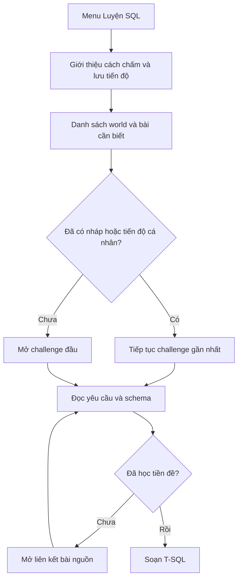
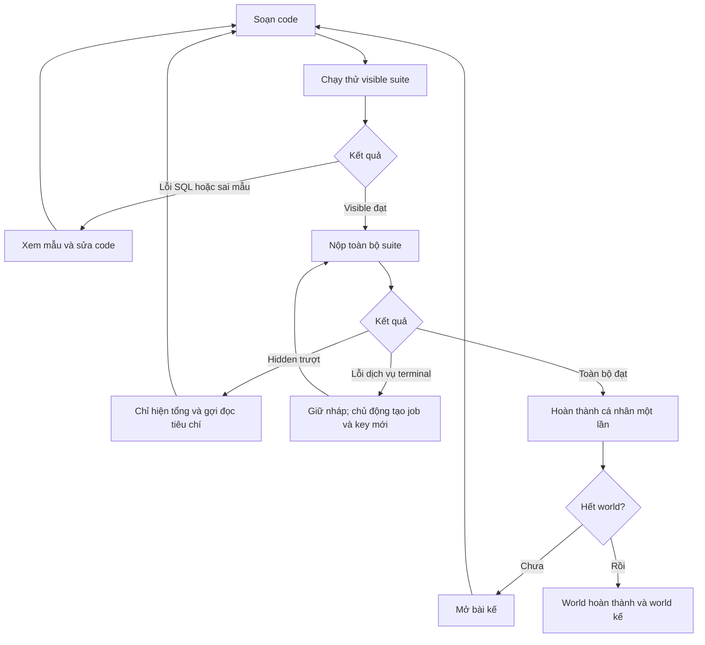
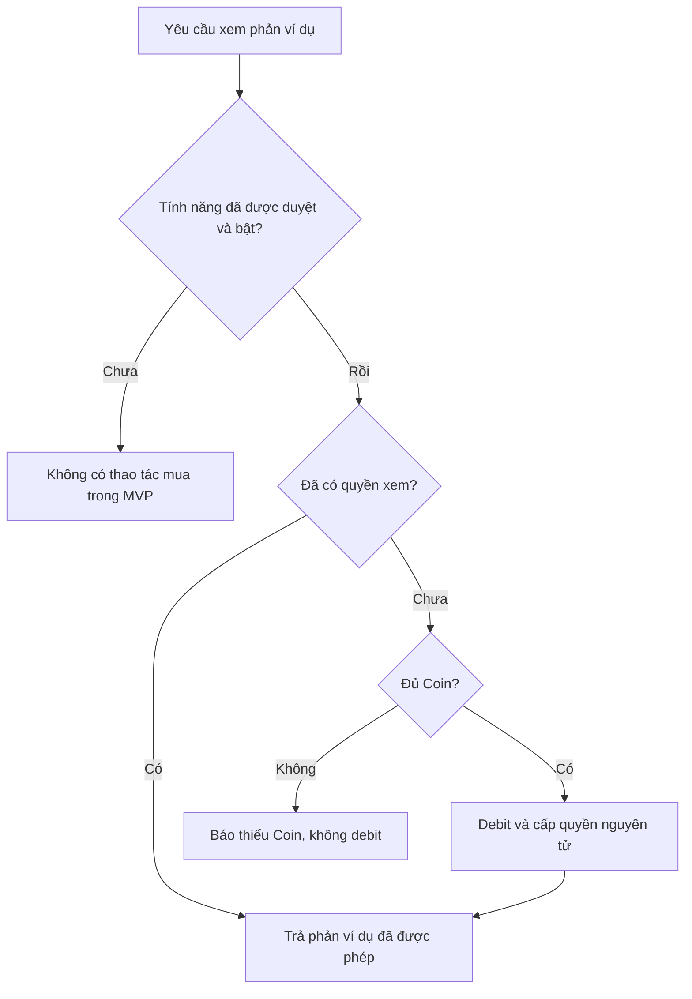

# 09. Luồng người dùng

Flow dưới đây là **RECOMMENDATION cho SQL Arcade**, không phải recording Arcade gốc. Bằng chứng lịch sử dẫn tới mục tiêu trải nghiệm nằm ở [01](01-historical-research.md); state guards ở [04](04-state-machines.md).

## 1. Lần đầu và tiếp tục học

Không bắt người chỉ dùng web mở SSMS. Mã truy cập dùng cơ chế hiện có của khóa học; vị trí nhận mã giữ theo hướng dẫn khóa học, không tự thêm thông tin liên hệ. Mã không phải identity hay ví Coin. [R-06, R-19]

## 2. Thử, sửa, nộp và mở tiếp

Có thể Submit trực tiếp; không bắt Run đạt trước. Sơ đồ thể hiện nhịp học được khuyến nghị, không phải điều kiện API. Run không cấp XP. Luyện lại challenge hoàn thành không cộng lần hai. [BR-01–BR-06]

## 3. Lỗi và khả năng khôi phục

| Tình huống | Đường đi bắt buộc |
|---|---|
| Thiếu/sai mã truy cập | Giữ SQL, mở form mã hiện có, gửi lại sau khi người học nhập |
| Version không còn được chấm | Báo đề đã đổi; giữ nháp cũ, cho mở bản mới; không tự nộp SQL vào version khác |
| Rớt mạng sau create job | Lưu idempotency key, gửi lại đúng payload/key hoặc poll job đã biết |
| Refresh khi job chạy | Đọc nháp/job token trong session; tiếp tục poll; nếu hết hạn thì thông báo cần nộp lại |
| SQL quá lâu | Trả query timeout; chỉ ghi lần thử thất bại, không xóa completion cũ |
| Worker reset lỗi | Service error, cách ly slot; không gán sai cho học viên |
| Đã biết service_error terminal | Poll hoặc key cũ vẫn là job cũ; nút Thử lại do người học chọn tạo job/key mới; không tự lặp |
| localStorage bị chặn | Cảnh báo không lưu nháp/progress trên thiết bị; phiên hiện tại vẫn làm được |
| Hai tab cùng hoàn thành | Completion set theo challenge/version, XP tính từ tập completion, không cộng event vào số dư |
| Sang máy khác | Xuất/nhập JSON Arcade để mang tiến độ; không hứa đồng bộ tự động |

## 4. Reveal tương lai, chưa bật

Sơ đồ này là ràng buộc cho thiết kế sau, không phải mô phỏng giao dịch đã thử. Identity, giá, nội dung reveal và holdout còn cần duyệt. Xem [06](06-business-rules.md) và AC-25/AC-26 tại [17](17-acceptance-tests.md).
