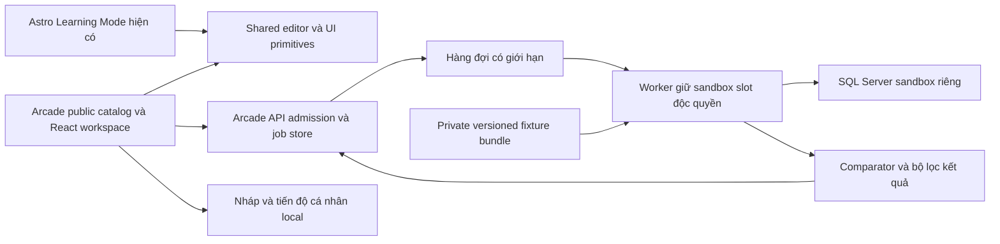

# 14. Kiến trúc đề xuất cho SQL Arcade

**RECOMMENDATION, chưa triển khai.** Phạm vi bản đầu theo [13](13-sql-arcade-proposal.md): query-only, 10 challenge, local personal progress, không wallet. Những con số vận hành là mục tiêu spike, chưa đo trên tài nguyên thật. Quyết định host/cost DEC-02 cần duyệt trước khi tạo hạ tầng.

## 1. Các ranh giới cần giữ

- Learning Mode và API `ping/run/grade` cũ giữ hợp đồng hiện tại. Thêm route/API Arcade riêng, không đổi ý nghĩa Chạy hiện có thành Run Tests.
- Tái dùng editor T-SQL, highlight, bảng kết quả, dialog và các thành phần ERD phù hợp. Tách UI shell khi triển khai, không thay editor engine chỉ để giống CodeSignal. [R-02–R-04, R-16]
- Public catalog chứa đề tự soạn, schema, sample và tiêu chí. Private bundle chứa hidden fixture, reference SQL/golden expected, mutant và version manifest; không ở public repo hoặc frontend build.

## 2. Runner và cô lập dữ liệu

Khuyến nghị pool khởi đầu **hai sandbox slot**, mỗi slot là SQL Server database/container riêng, chỉ có một job giữ lease. Worker cùng host/coordinator phải dùng lease có fencing token để worker cũ không tiếp tục chạy sau khi mất quyền. Không cấp hai job cùng một slot; không dùng schema chung giữa nhiều job làm ranh giới an ninh.

Trong từng scenario: trusted loader reset schema cố định và seed dữ liệu giả vào **sandbox riêng**; xác nhận fixture digest; kết nối học viên bằng principal chỉ có SELECT trên bảng scenario; chạy query; thu shape/result; hủy/đóng phiên; reset và kiểm sạch trước scenario kế. Reference expected được sinh/kiểm ở pipeline private, không chạy bằng quyền admin trong request SQL học viên.

Loader có credential riêng, không đưa vào session query. Query principal không có mapping/quyền đọc database khác, linked server, external access, DDL/DML hoặc quyền đọc bảng job/fixture manifest. Không đặt toàn bộ hidden dataset trong các bảng khác mà cùng principal có SELECT. Metadata engine công khai không được chứa secret fixture.

Mất lease, mất kết nối, timeout hoặc reset không xác nhận sạch: cách ly slot và xử lý lại bằng môi trường sạch, không trả lại pool theo giả định. Worker giới hạn CPU/memory/output và network egress; command timeout không thay cho resource cap. Không gọi backup/restore hoặc lệnh tạo tài nguyên trong lượt nghiên cứu này.

`ROLLBACK` của runner hiện tại là thứ có thể học lại về nguyên tắc, không phải bằng chứng rằng pool chia dữ liệu mới đã cô lập. Nó cũng không xóa lock contention/CPU/I/O. [R-08–R-12, M-04]

## 3. Policy SQL và so sánh

Server áp policy query-only trước khi tạo job. Không tái dùng guard nhận DML làm policy duy nhất. Cần parser T-SQL có AST hoặc validator tương đương được kiểm chứng: một SELECT/CTE SELECT, object allowlist, chặn SELECT INTO, write-capable expression/EXEC/multi-statement, cross-database/external access và control transaction/session. Parser package cụ thể là nội dung spike; không tự cài hay chọn dependency chưa đánh giá trong tài liệu nghiên cứu.

Quyền database và môi trường cô lập vẫn là ranh giới cuối; parser/regex không tự thành sandbox. Các kỹ thuật bypass, lock hint, recursion, lỗi chứa dữ liệu và query tốn tài nguyên phải có acceptance test. Không hứa ngăn mọi SQL độc hại bằng từ khóa chặn. [FR-09, AC-19–AC-22]

Comparator mới chỉ cho Arcade, theo [07](07-testing-and-scoring.md). MVP hỗ trợ output family int32/text/date/bit; numeric nguyên khác SQL integer type vẫn so được nếu biểu diễn chính xác, text `"1"` không tự coi như số 1. Decimal/float/BIGINT ngoài miền, datetime fractional/offset phải trả lỗi loại kết quả chưa hỗ trợ thay vì làm tròn âm thầm. Không thay semantics comparator cũ.

Collation sandbox đề xuất `Latin1_General_100_CI_AS_SC` cho dữ liệu `nvarchar`, được ghi trong version manifest và công khai tác động hoa/dấu. Phải xác minh availability/hành vi trên engine được chọn ở spike. Không tuyên bố collation HRM_Demo live đang là giá trị này. [M-03]

## 4. API, quota và ownership job

Giữ access-code gate hiện có cho phép sử dụng dịch vụ; code không là learner identity. Khi tạo job, server cấp job token ngẫu nhiên ít nhất 128 bit, lưu hash; poll cần token và code hợp lệ. Không dùng ID tuần tự hoặc SQL hash làm token. Token chỉ cho đọc một job, không cho đọc fixture/SQL người khác. Không đưa token vào query string, URL analytics hoặc log.

Idempotency key UUID do client tạo cho **một lần hành động trên một snapshot SQL**, không tái dùng key Run khi Submit. Lookup scope là access-code scope + key; digest là JSON array canonical `[mode, challengeId, challengeVersion, normalizedSql]`, chỉ chuẩn hóa CRLF/CR thành LF, không đổi chữ/nháy/comment. Retry key/digest đã nhận trong 24 giờ không chạy lại hoặc tiêu thêm execution quota; cùng key nhưng đổi mode hoặc payload trả 409. Client tạo key mới cho hành động chạy/nộp mới, kể cả SQL không đổi.

Job queued tối đa 30 giây, running tổng tối đa 30 giây; từng scenario 5 giây. Token poll hết hạn 15 phút từ lúc nhận job; job/payload và idempotency tombstone giữ 24 giờ rồi xóa. Trong thời gian còn record: token/key đã hết hạn trả 410, không tạo execution mới. Sau purge: GET trả 404, POST reuse key có thể được coi là admission mới; không hứa chống replay vô hạn. UI dừng retry tự động khi hết hạn và chỉ người học chủ động tạo lần chạy mới. Đây là retention đề xuất, không là chính sách CodeSignal.

Job terminal không được mở lại. Mất mạng/chưa biết kết quả thì poll/replay key cũ; đã biết terminal `service_error` thì nút Thử lại tạo job/key mới có chủ ý. Không auto retry lỗi terminal. Tắt hoặc hết quota vẫn giữ nháp và completion cá nhân trước đó.

Distributed limiter khởi đầu: 2 slot toàn hệ thống, 1 active job/access code, 6 job/phút/code; poll có quota riêng tối đa 60/phút/token. Nếu code được chia cả lớp, một active/code sẽ gây chờ; pilot phải cấp code riêng hoặc duyệt đổi quota trước mở lớp, không âm thầm scale vô hạn. [R-12]

## 5. Public/private và nguy cơ lộ hidden

| Bề mặt | Quy định |
|---|---|
| Public Git/HTML/JS/source map | Không reference SQL, hidden data/expected hoặc secret; scan cả artifact và source map |
| API Run | Chỉ sample, cap hiển thị rõ; không cache chung kết quả có job token |
| API Submit | Chỉ visible detail và hidden tổng; enum lỗi hidden chung, không raw message/table/value/plan |
| Log | Job ID, digest/version, duration, category; không token/code, SQL đầy đủ hoặc dữ liệu fixture |
| Job store | Access restricted; SQL là payload ngắn hạn, không public submission history |
| Query connection | Chỉ fixture đang chạy; không quyền đọc job store/fixture registry |
| Reveal tương lai | Chỉ nội dung đã cấp quyền; holdout không reveal; authorization server |

Ngay cả chỉ pass/fail/tổng cũng là một oracle có thể bị dò. Private storage không bảo đảm bí mật tuyệt đối; rate limit, nhiều phản ví dụ và thay fixture theo version giảm rủi ro. Không cho người học nộp dữ liệu thật/PII trong sandbox mẫu.

## 6. Tiến độ, tương thích và mở rộng

MVP dùng namespace Arcade mới cho draft, last job và completion. XP tính `10 × số challengeId duy nhất đã đạt`, không lưu ví tăng/giảm bằng event. Lưu completed version riêng; version cũ không tự thành pass version mới. `unlockedChallengeIds` chỉ tăng trong tiến độ cá nhân, không tự khóa lại bài đã mở khi catalog đổi. Nội dung đổi mục tiêu lớn dùng challenge ID mới.

Cross-tab hợp nhất theo union completion/unlock và thời điểm nháp mới nhất; same-challenge completion không cộng XP hai lần. Đây là lưu cá nhân có thể sửa/mất, không authority server hay giao dịch chống gian lận. Xuất/nhập JSON riêng, không ghi đè progress v1. Khi cần coin/chứng nhận/cross-device sync phải thiết kế learner identity và server progress migration riêng; không import local XP thành số dư đáng tin.

## 7. Rollout và quan sát tương lai

Feature flag Arcade mặc định tắt đến khi spike/security/content gates đạt. Pilot nhỏ, đo queue time, query time, reset failure, timeout, rate-limit, result size và chi phí tổng; log không dữ liệu hidden. Dừng cấp job nếu reset failure hoặc isolation breach; không tự retry query vô hạn. Tắt Arcade không ảnh hưởng bài học/API cũ. Ngưỡng thông báo: bất kỳ isolation breach/reset digest sai thì ngừng slot; service error trên 5% trong 10 phút thì dừng admission và kiểm nguyên nhân. Chưa cấu hình giám sát hay deploy.
