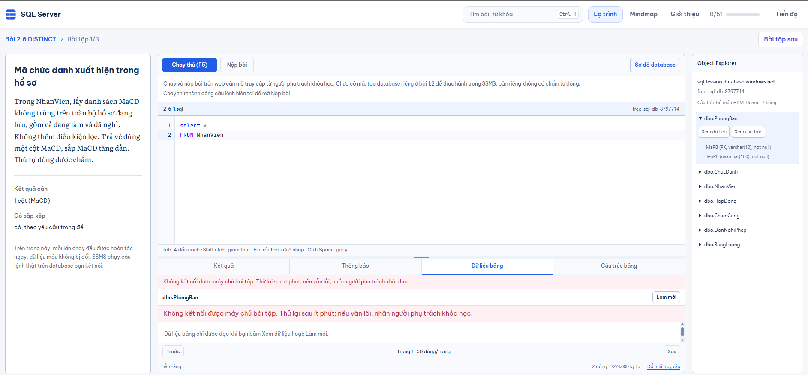

# Lỗi kết nối API khi review local — chưa xử lý

Người dùng báo lỗi sau khi nhận bản workspace tại commit `f195b34` trên nhánh `codex/ssms-exercise-workspace`. Theo yêu cầu tiếp theo, dừng sửa lỗi, ghi nhận và push nhánh để lưu công việc; không merge vào `main`.

## Hiện tượng và nơi xảy ra

- Chrome đang mở `http://localhost:4321/microsoft-sql-lession/bai/2-6-distinct-bo-dong-trung/bai-tap/1/`, khác bản preview bàn giao tại `http://127.0.0.1:4330/`.
- Người dùng nhập câu đọc bảng `NhanVien`, chạy thử hoặc chọn **Xem dữ liệu** của `PhongBan`.
- Trang báo **“Không kết nối được máy chủ bài tập. Thử lại sau ít phút; nếu vẫn lỗi, nhắn người phụ trách khóa học.”** Không có dữ liệu trả về, Nộp bài vẫn khóa.
- Ảnh người dùng còn cho thấy cùng thông báo xuất hiện hai lần trong tab Dữ liệu bảng; ghi nhận để kiểm khi sửa, chưa kết luận là nguyên nhân mất kết nối.

## Bằng chứng đã kiểm

1. Checkout vẫn sạch, nhánh `codex/ssms-exercise-workspace`, commit `f195b34`; chưa sửa sản phẩm sau báo lỗi.
2. Đọc giao diện Chrome xác nhận URL **localhost:4321** và câu SQL của người dùng còn nguyên. Không đổi nội dung editor, mã truy cập hoặc storage của người dùng.
3. `.env.development` đang đặt `PUBLIC_EXERCISE_API=http://localhost:7071/api`. Kiểm socket không có listener ở **7071**; frontend dev đang nghe **4321**.
4. API review vẫn có listener tại **127.0.0.1:7073**; preview frontend vẫn có listener tại **127.0.0.1:4330**. Log API không có stderr được ghi ở thời điểm kiểm.
5. Gọi HTTP `/api/ping` trên 7073 không kèm mã nhận **401 bad-code**, chứng minh HTTP service còn đáp ứng; không chứng minh kết nối SQL hoặc mã người dùng hợp lệ.
6. Với cả Origin `http://127.0.0.1:4330` và `http://localhost:4330`, API 7073 đều trả `Access-Control-Allow-Origin: http://127.0.0.1:4330`. Vì vậy đổi sang cổng 7073 đơn thuần chưa đủ cho frontend **localhost:4321**: origin cũng cần khớp cấu hình dev.

## Nhận định và phần chưa xác minh

Đã thấy môi trường local không đồng bộ: trang người dùng mở dùng cấu hình mặc định trỏ tới API 7071 đang không chạy, trong khi API của bản review dùng 7073 và chỉ cho origin 127.0.0.1:4330. Đây là hướng nguyên nhân có bằng chứng cho lỗi kết nối; chưa ghi network trace request thực tế của tab Chrome để xác nhận toàn bộ chuỗi lỗi.

Chưa sửa cấu hình, khởi động API 7071, đổi CORS, đổi mã truy cập, chạy SQL hoặc kiểm lại đường đi lỗi. Chưa có bằng chứng để kết luận database bị hỏng hoặc API production gặp lỗi. Kết quả nghiệm thu trước đó thuộc cặp frontend/API 4330/7073, không dùng thay cho xác nhận trang 4321 hiện hoạt động.

## Việc cần làm ở lượt sửa tiếp theo

- Xác nhận URL API thực tế trong request của trang 4321, rồi thống nhất một cặp frontend/API local và origin cho phép; giữ auth và bind loopback.
- Kiểm lỗi thiếu API bằng test phù hợp, hướng dẫn chạy local và trạng thái lỗi có hành động khôi phục rõ ràng.
- Chạy lại Chạy thử, Nộp bài và preview bằng trình duyệt trên đúng URL người dùng dùng; giữ nháp/mã và chỉ đọc database hoặc chạy qua runner hoàn tác.
- Kiểm việc thông báo lỗi bị hiển thị lặp trong tab dữ liệu, ghi riêng với lỗi kết nối.

Trạng thái bàn giao: **lỗi đang mở, chưa sửa**. Người dùng chỉ cho phép commit/push lên nhánh tính năng rồi chuyển checkout về `main`, không cho merge/publish thay đổi này.
